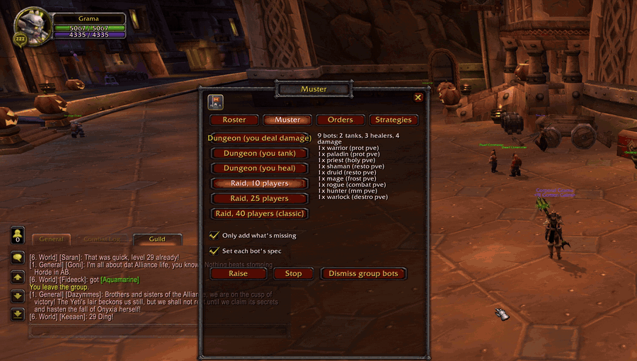
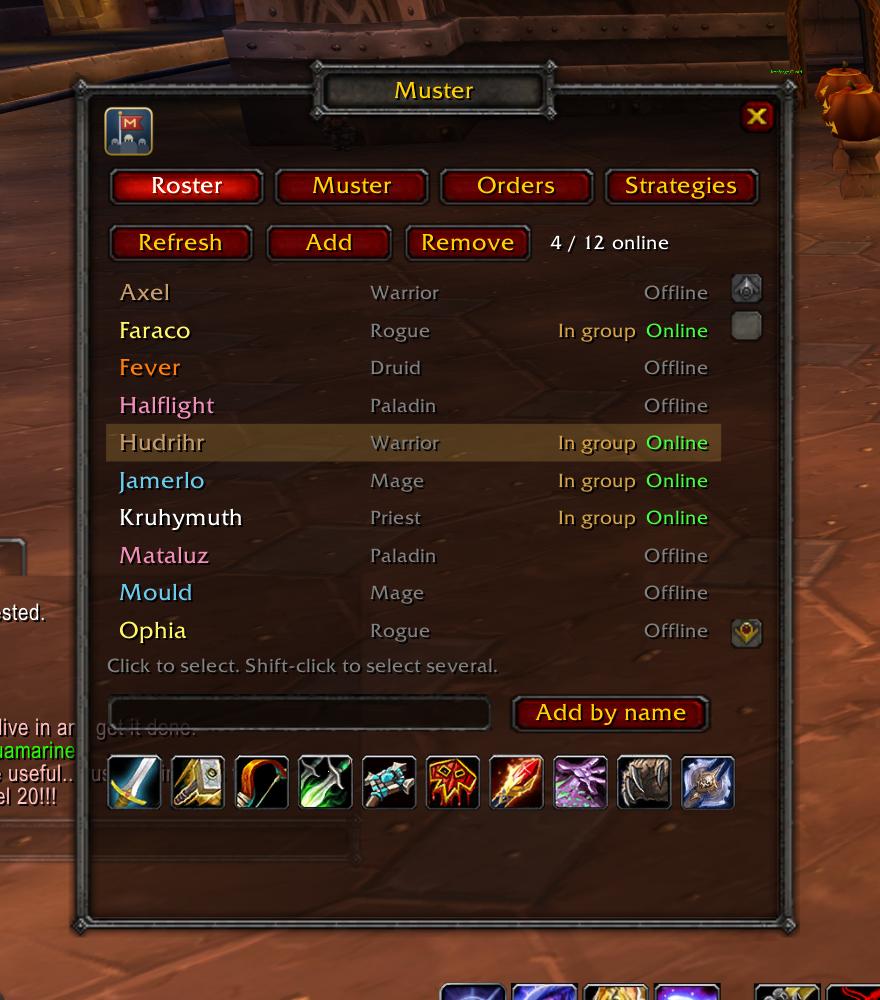
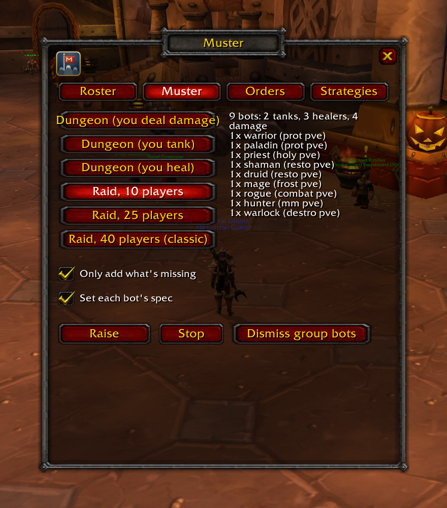
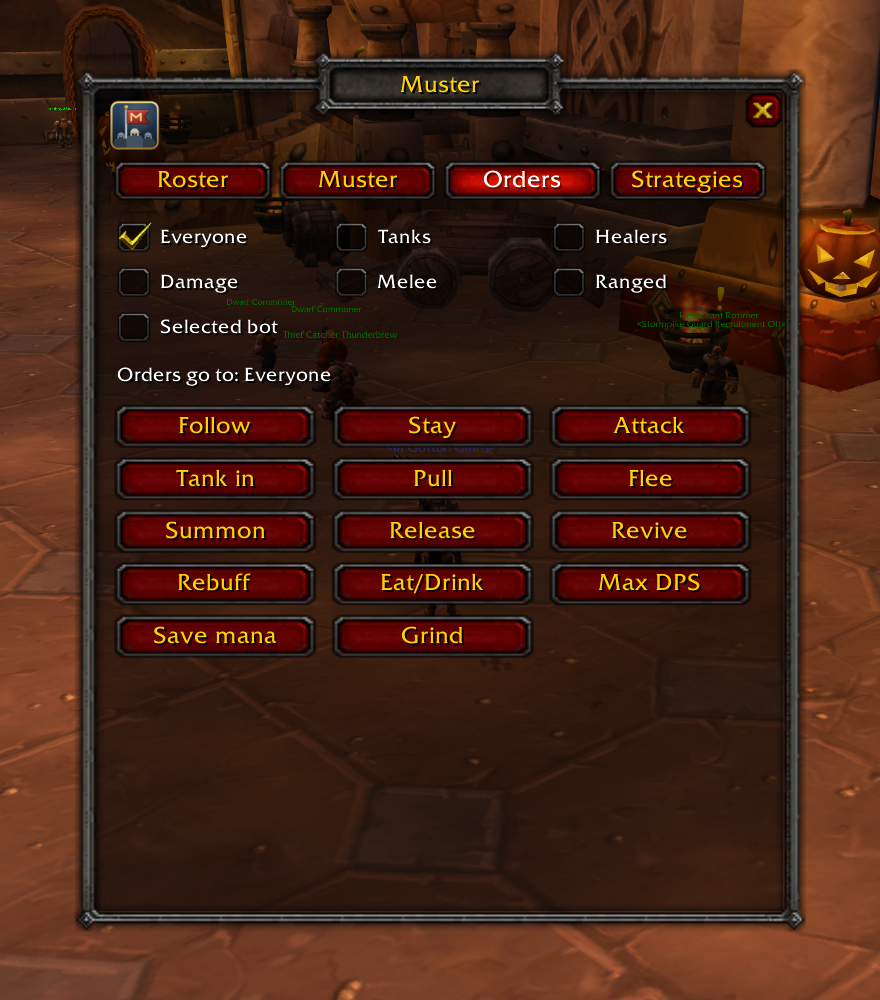
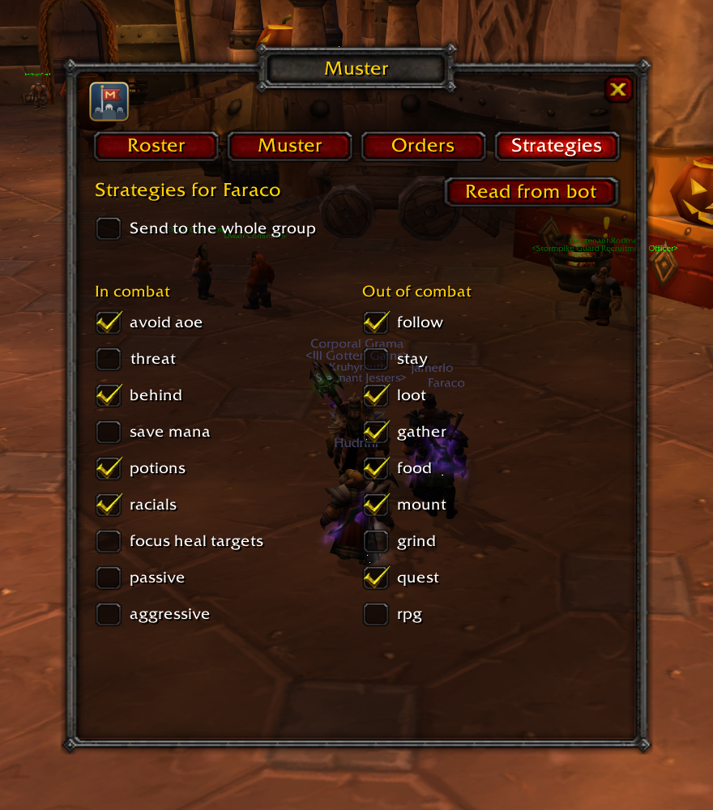

<p align="center">
  
</p>

<h1 align="center">Muster</h1>

<p align="center">
  A World of Warcraft 3.3.5a addon for <a href="https://github.com/mod-playerbots/mod-playerbots">mod-playerbots</a>.<br>
  Raise a whole dungeon or raid group in one click, give orders, and tune each bot's strategies, all from one panel.
</p>

<p align="center">
  <a href="https://mrguato.github.io/muster/"><b>Docs</b></a> ·
  <a href="https://github.com/MrGuato/muster/releases/latest"><b>Download</b></a> ·
  <a href="https://github.com/MrGuato/muster/blob/main/CHANGELOG.md"><b>Changelog</b></a> ·
  <a href="https://github.com/mod-playerbots/mod-playerbots"><b>mod-playerbots</b></a>
</p>

<p align="center">
  <a href="https://github.com/MrGuato/muster/releases"></a>
  <a href="https://github.com/MrGuato/muster/actions/workflows/lint.yml"></a>
  <a href="https://github.com/MrGuato/muster/actions/workflows/tests.yml"></a>
  <a href="https://github.com/MrGuato/muster/actions/workflows/security.yml"></a>
  <a href="https://github.com/MrGuato/muster/actions/workflows/codeql.yml"></a>
  <a href="LICENSE"></a>
  <a href="https://github.com/MrGuato/muster/commits/main"></a>
  <a href="https://github.com/MrGuato/muster/releases"></a>
  
</p>

---

1. Download `Muster-<version>.zip` from the [latest release](https://github.com/MrGuato/muster/releases/latest).
2. Unzip it into `World of Warcraft/Interface/AddOns/`, so you end up with `Interface/AddOns/Muster/Muster.toc`.
3. Log in and type `/muster`.

Press **Refresh** on the Roster tab to see your bots, or go to the Muster tab, pick **Dungeon** and press **Raise**.

<p align="center">
  
</p>

| Roster | Muster |
| --- | --- |
|  |  |
| **Orders** | **Strategies** |
|  |  |

## What it does

| Tab | What you get |
| --- | --- |
| **Roster** | Every bot the server lets you log in, with class colours, who's online and who's in your group. Add or remove them by selection, by name, or one of any class with a click on its icon. |
| **Muster** | Raise a full group from a template: three 5-man dungeon groups (whether you tank, heal or deal damage), 10, 25, and a classic 40-man raid. Muster can add only what your group is missing, and tells each new bot the spec its slot needs, so the tank slot really tanks. |
| **Orders** | Follow, stay, attack, tank in, pull, flee, summon, release, revive, rebuff, eat/drink, max DPS, save mana, grind. Send them to everyone, to one role (tanks, healers, damage, melee, ranged), or to a single bot. |
| **Strategies** | Read a bot's in-combat and out-of-combat strategies and switch them with checkboxes: avoid AoE, threat, behind, save mana, potions, loot, gather, follow, grind and more, each with a tooltip saying what it does. Or switch one for the whole group. |

**Command bar.** Every command as an icon, without opening the window: a small bar of category icons (orders, bots, raise, combat and out-of-combat strategies), each opening a column of commands above it. Every icon's tooltip says what it does and the exact line it sends. Right-click any command to pin it to the bar as a one-click shortcut; follow, stay, attack and flee are pinned to start with.

Also: a minimap button (left-click opens Muster, shift-click shows or hides the bar, right-click refreshes the roster), key bindings for the window, the bar and the five most used orders, and a `/muster` slash command for all of it.

## Slash commands

```
/muster                     show or hide the window
/muster list                refresh your bot roster
/muster add Aldric,Mira     log in bots by name
/muster remove Aldric       log a bot out
/muster class mage          add a bot of a class
/muster raise raid40        raise a group from a template
/muster stop                stop raising
/muster order follow tank   give an order, optionally to one role
/muster bar                 show or hide the command bar
/muster minimap             show or hide the minimap button
/muster minimap reset       put the minimap button back in its starting place
```

Templates: `dungeon`, `dungeon-tank`, `dungeon-heal`, `raid10`, `raid25`, `raid40`. Full reference in the [docs](https://mrguato.github.io/muster/commands).

## Requirements

- A **WoW 3.3.5a** (12340) client.
- An **AzerothCore** server with **[mod-playerbots](https://github.com/mod-playerbots/mod-playerbots)**. Muster only sends the chat commands mod-playerbots already understands, so there's nothing to install on the server.
- For the template buttons, the server needs `Playerbots.AddClassCommand = 1` (or your account must be a GM), and `Playerbots.MaxAddedBots` at least as large as the group you raise: 39 for a 40-man. See [server settings](https://mrguato.github.io/muster/server).

## How it works

Muster has no server part. Everything is chat the server already listens for:

- `.playerbot bot add|remove|addclass|list` for logging bots in and out. The answers come back as system messages, which Muster reads.
- Orders and strategy changes said in party or raid chat (`follow`, `@tank attack`, `co +avoid aoe`) or whispered to one bot.
- `talents spec prot pve` whispered to a freshly added bot, to pick one of mod-playerbots' premade specs.

That means it works with any mod-playerbots version that has these commands, and you can see every line it sends in the [docs](https://mrguato.github.io/muster/commands#what-muster-sends).

## Credits

Muster is written from scratch for current mod-playerbots. It was inspired by **UnBot** ([liyunfan1223/unbot-addon](https://github.com/liyunfan1223/unbot-addon)), the original playerbots control addon, but shares no code or art with it.

World of Warcraft is a trademark of Blizzard Entertainment. Muster is a fan-made addon and isn't affiliated with Blizzard, AzerothCore or the mod-playerbots project.

## License

[MIT](LICENSE). Use it, change it, share it.
